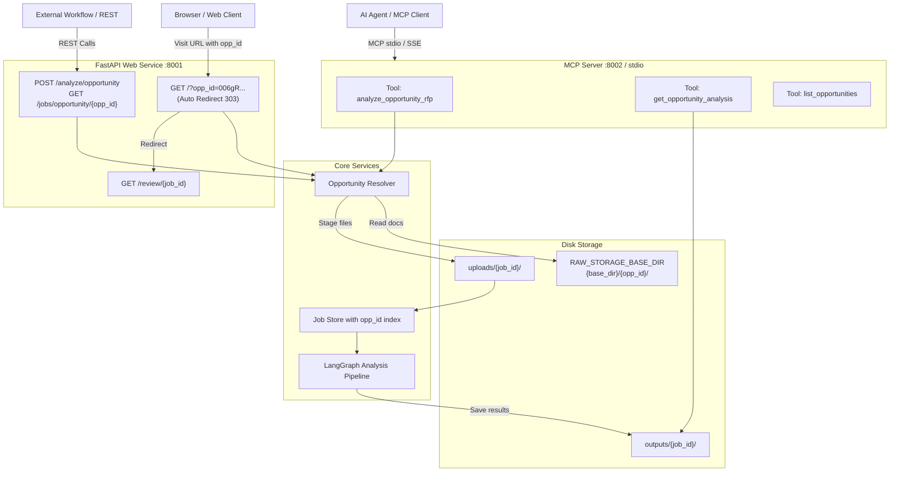

# RFP Analyzer V2 — MCP & Opportunity ID Integration Guide

This guide documents the changes made to RFP Analyzer V2 to support **automated Opportunity ID (`opp_id`) ingestion** directly from raw disk storage and **Model Context Protocol (MCP)** exposure for external AI agents and workflows.

---

## 1. Architecture Overview



---

## 2. Configuration Settings

Add these environment variables to your `.env` file or environment:

| Variable | Description | Default Value |
|---|---|---|
| `RAW_STORAGE_BASE_DIR` | Base directory containing raw opportunity folders | `C:\Agents\StarterKit-v0.1\Framework\backend\data\storage\inputs\raw` (falls back to `./data/storage/inputs/raw` if not present) |
| `RFP_ANALYZER_BASE_URL` | Base URL used to build browser review links in MCP tool responses | `http://localhost:8001` |
| `UPLOAD_DIR` | Directory where uploaded and staged files are stored | `./uploads` |
| `OUTPUT_DIR` | Directory where results (`job.json`, `result.json`, `result.md`, `working.json`) are stored | `./outputs` |

---

## 3. Opportunity ID Folder Resolution

When an `opp_id` is supplied (e.g. `006gR000005bd2jQGG`), the resolver (`core/opportunity_resolver.py`) locates the folder using three strategies:

1. **Direct Match**: Looks for `{RAW_STORAGE_BASE_DIR}/{opp_id}`.
2. **Substring Match**: Searches for subdirectories containing the `opp_id` string (e.g. `raw/006gR000005bd2jQGG-AcmeCorp/`).
3. **UUID Wrapper Search**: Scans subfolders (such as UUID folders `raw/bb39d713-3d4b-4a85-984b-e6633f44bdbd/`) for child folders or files matching the `opp_id`.

### Automatic File Discovery & Role Assignment
- **Supported File Extensions**: `.pdf`, `.docx`, `.doc`, `.txt`, `.xlsx`, `.xls`
- **Role Heuristics**:
  - `qna`: Filenames containing `qna`, `q_and_a`, `questions`, `clarifications`, or `qa`.
  - `annexure`: Filenames containing `annex`, `appendix`, `attachment`, `exhibit`, `schedule`.
  - `primary`: Filenames containing `rfp`, `sow`, `requirement`, `spec`, or default main document.
- **Primary Document Selection**: Selected automatically (named primary > largest PDF > largest file).

---

## 4. Web URL Auto-Analysis

Navigate directly to:
```
http://localhost:8001/?opp_id=006gR000005bd2jQGG
```

### Flow:
1. Checks if a job already exists for this `opp_id`.
   - If **COMPLETE** or **RUNNING**, immediately redirects to `/review/{job_id}`.
   - If not found or failed, loads the files from disk, stages them in `uploads/{job_id}/`, starts the analysis pipeline in the background, and redirects to `/review/{job_id}`.
2. The user sees live progress on `/review/{job_id}` without having to manually upload any files.
3. The review page header displays `· Opp {opp_id}` in its metadata bar.

---

## 5. REST API Endpoints

### 1. Trigger / Reuse Opportunity Analysis
```http
POST /analyze/opportunity?opp_id=006gR000005bd2jQGG&force=false
```

**Response (`200 OK`):**
```json
{
  "job_id": "35bc367e-5b87-48a0-8369-a1d100472428",
  "status": "pending",
  "opp_id": "006gR000005bd2jQGG"
}
```

- Pass `force=true` to bypass deduplication and force a re-analysis from scratch.

### 2. Query Job Status by Opportunity ID
```http
GET /jobs/opportunity/006gR000005bd2jQGG
```

**Response (`200 OK`):**
```json
{
  "job_id": "35bc367e-5b87-48a0-8369-a1d100472428",
  "opp_id": "006gR000005bd2jQGG",
  "status": "complete",
  "primary_file_name": "RFP-Overview.pdf",
  "file_names": ["RFP-Overview.pdf", "Appendix_A.xlsx"],
  "file_roles": {
    "RFP-Overview.pdf": "primary",
    "Appendix_A.xlsx": "annexure"
  },
  "created_at": "2026-10-10T21:40:00.000000",
  "updated_at": "2026-10-10T21:42:30.000000"
}
```

---

## 6. Model Context Protocol (MCP) Server

The MCP server is implemented in `mcp_server.py` using Python's official `mcp` SDK (FastMCP).

### Available MCP Tools

| Tool Name | Parameters | Description |
|---|---|---|
| `analyze_opportunity_rfp` | `opp_id: str`<br/>`force: bool = False` | Resolves files from the raw storage folder, starts background analysis (or reuses existing run), and returns `job_id`, `status`, and `review_url`. |
| `get_opportunity_analysis` | `opp_id: str` | Retrieves status, archetype scores, top risk items, skills extraction counts, and full Markdown report for the opportunity. |
| `list_opportunities` | *(none)* | Scans `RAW_STORAGE_BASE_DIR` and returns a list of all opportunities with file counts, detected extensions, and current analysis status. |

---

## 7. MCP Client Configuration

### A. IBM Bob Configuration (`.bob/mcp.json`)

To configure this server in IBM Bob, add the following to your workspace or user `.bob/mcp.json`:

```json
{
  "mcpServers": {
    "rfp-analyzer": {
      "command": "python",
      "args": [
        "c:/Agents/V2/mcp_server.py",
        "--transport",
        "stdio"
      ],
      "env": {
        "RAW_STORAGE_BASE_DIR": "C:\\Agents\\StarterKit-v0.1\\Framework\\backend\\data\\storage\\inputs\\raw",
        "RFP_ANALYZER_BASE_URL": "http://localhost:8001"
      }
    }
  }
}
```

### B. Claude Desktop Configuration (`claude_desktop_config.json`)

On Windows, edit `%APPDATA%\Claude\claude_desktop_config.json`:

```json
{
  "mcpServers": {
    "rfp-analyzer": {
      "command": "python",
      "args": [
        "c:/Agents/V2/mcp_server.py",
        "--transport",
        "stdio"
      ],
      "env": {
        "RAW_STORAGE_BASE_DIR": "C:\\Agents\\StarterKit-v0.1\\Framework\\backend\\data\\storage\\inputs\\raw",
        "RFP_ANALYZER_BASE_URL": "http://localhost:8001"
      }
    }
  }
}
```

### C. Cursor Configuration (`.cursor/mcp.json`)

```json
{
  "mcpServers": {
    "rfp-analyzer": {
      "command": "python",
      "args": [
        "c:/Agents/V2/mcp_server.py",
        "--transport",
        "stdio"
      ]
    }
  }
}
```

### D. Running over SSE (Server-Sent Events)

If external network clients or Docker containers need to connect via HTTP SSE:

```powershell
python mcp_server.py --transport sse --host 0.0.0.0 --port 8002
```

Client SSE URL: `http://localhost:8002/sse`

---

## 8. Running the Application & MCP Server

### 1. Start the Web App
```powershell
uvicorn app.main:app --port 8001 --reload
```

### 2. Start the MCP Server (stdio mode)
```powershell
python mcp_server.py --transport stdio
```

### 3. Run Automated Tests
```powershell
pytest tests/test_opportunity_resolver.py tests/test_start_opportunity_analysis.py tests/test_opportunity_web_and_api.py tests/test_mcp_server.py tests/test_opportunity_analysis.py
```
*(All 371 tests across the test suite pass with 0 failures.)*

---

## 9. Summary of Changed Files

| File | Type | Changes |
|---|---|---|
| [`core/opportunity_resolver.py`](core/opportunity_resolver.py) | **New** | Directory scanning, substring/UUID match, file discovery, and role classification. |
| [`mcp_server.py`](mcp_server.py) | **New** | FastMCP server exposing `analyze_opportunity_rfp`, `get_opportunity_analysis`, `list_opportunities`. |
| [`app/config.py`](app/config.py) | **Modified** | Added `get_raw_storage_dir()` supporting `RAW_STORAGE_BASE_DIR`. |
| [`app/job_store.py`](app/job_store.py) | **Modified** | Added `opp_id` to `AnalysisJob`, sidecar persistence, and `get_job_by_opp_id()` lookup. |
| [`app/routers/analysis.py`](app/routers/analysis.py) | **Modified** | Added `start_opportunity_analysis()` service function, `POST /analyze/opportunity`, and `GET /jobs/opportunity/{opp_id}`. |
| [`app/main.py`](app/main.py) | **Modified** | Added `opp_id` query parameter handling on `GET /` with automatic job start and 303 redirect. |
| [`app/templates/home.html`](app/templates/home.html) | **Modified** | Added error message banner for missing/invalid opportunity folders. |
| [`app/templates/review.html`](app/templates/review.html) | **Modified** | Exposed opportunity ID placeholder in review page script block. |
| [`app/static/js/review.js`](app/static/js/review.js) | **Modified** | Rendered `· Opp {opp_id}` badge in the review header meta bar. |
| [`pyproject.toml`](pyproject.toml) | **Modified** | Added `mcp>=1.2.0` dependency. |
| [`README.md`](README.md) | **Modified** | Added Opportunity ID and MCP configuration sections. |
| [`tests/test_opportunity_*.py`](tests/) | **New** | 100+ unit, integration, and end-to-end tests covering all opportunity flows. |
